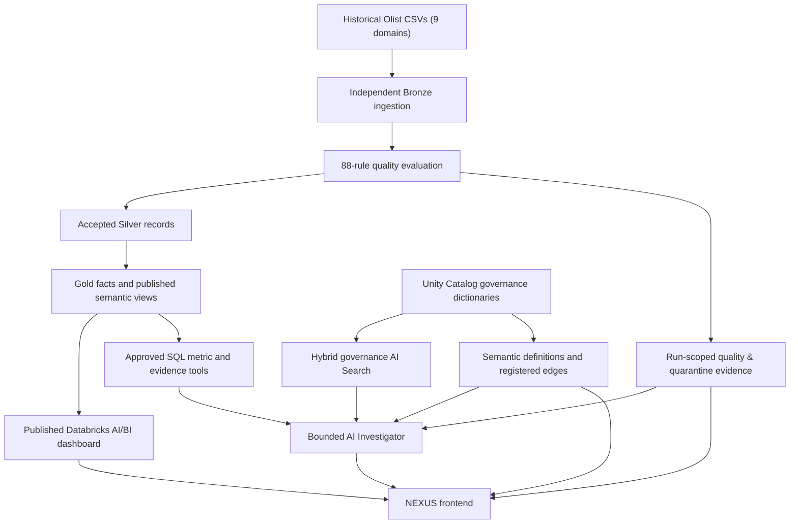

# OLIST // NEXUS

**Agentic Operations Intelligence — a Databricks analytics, governance, and AI proof of concept**

[Open NEXUS in Databricks Apps](https://olist-agentic-operations-tower-7474659488161285.aws.databricksapps.com/nexus) · [Explore the architecture](docs/ARCHITECTURE.md) · [Review live agent evaluations](docs/LIVE_AGENT_EVALUATION_2026-10-12.md)

> **Project status (October 2026):** Implemented and deployed as a Databricks App. NEXUS is the only maintained frontend; the root route redirects to `/nexus`. Application access depends on the Databricks workspace's permissions. This is a **functional POC**, not a production service.

## Overview

Traditional dashboards help teams see *what* happened. Explaining *why* a number looks unusual, *whether* its underlying records passed quality controls, and *how* the metric was defined often takes additional investigation.

**OLIST // NEXUS** brings these steps together in a single investigative experience:

1. **Govern the data:** Evaluate source contracts and data-quality rules; quarantine disallowed records and track dependent exclusions.
2. **Publish trusted analytical inputs:** Expose a run-scoped historical dataset and governed metric definitions through Databricks Unity Catalog.
3. **Explore the business:** View published Databricks AI/BI dashboards, nationwide KPIs, and state-level delivery patterns.
4. **Investigate with AI:** Ask freeform questions; a bounded agent can select approved read-only SQL tools and retrieve governance documentation.
5. **Inspect evidence:** Review source identifiers, published-run provenance, quality findings, metric calculations, tool activity, and retrieved passages.

The source is the **[Brazilian E-Commerce Public Dataset by Olist](https://www.kaggle.com/datasets/olistbr/brazilian-ecommerce)**, covering historical Brazilian e-commerce activity from **2016–2018**. NEXUS runs SQL against a *published historical snapshot*; it does **not** receive live Olist transactions.

## Six NEXUS workspaces

| Workspace | What it provides |
| --- | --- |
| **Command Center** | Nationwide accepted/delivered order KPIs, delivered-item GMV, quality summary, and an interactive explorer for Brazil's 27 states/federal units. |
| **Live AI/BI Dashboard** | An embedded **published Databricks AI/BI dashboard**, with Operations Analytics, Data Trust & Quality, and Governed Metric Definitions pages, plus Databricks-native interactions/Genie access. |
| **Data Constellation** | Nine source-domain contracts, field explanations, logical relationships, rule outcomes, failed-record examples, and parent-child quarantine lineage. |
| **Quality Gate** | An interactive view of **88 governed rules**, with observed published-run status, enforcement, failure counts, and record-level impact. |
| **Semantic Lineage** | **13 governed metrics** with definitions, units, populations, exclusions, registered conceptual dependencies, and independent approved-SQL verification. |
| **AI Investigator** | Context-aware agentic questioning using allowlisted SQL tools, hybrid AI Search, governance evidence, and inspectable answer receipts. |

The Data Constellation's 3D graph shows **logical source relationships**, not automatically captured runtime lineage. Likewise, Semantic Lineage's registered edges document **project-defined conceptual dependencies**, not automatically discovered Unity Catalog runtime lineage. The independent state selector in NEXUS is **not synchronized** with filters inside the embedded AI/BI dashboard.

## Architecture



**Key components**

- **Databricks App / FastAPI:** Serves `/nexus`, the AI Investigator API, and the read-only NEXUS evidence endpoints.
- **Databricks SQL + Unity Catalog:** Holds published semantic views, source contracts, metric dictionaries, rule definitions, observed quality results, and provenance.
- **Databricks AI/BI + Genie:** Provides the native published dashboard and its own interactions.
- **Unity Gateway model service:** The agent uses `system.ai.gpt-oss-120b` through the Databricks model service, with model-selected **allowlisted** tools.
- **Hybrid AI Search:** Retrieves relevant governance and policy passages to supplement SQL-backed observations.
- **Evidence validation and fallback:** Certain claims are checked against run-scoped SQL evidence; a deterministic evidence-grounded answer is used when the agent path cannot produce a supported result.
- **MLflow / App Logs:** Instrumentation and privacy-bounded execution audit support debugging, subject to the observability caveat below.

**Authoritative-source distinction:** SQL-backed published-run results establish numerical outcomes (for example, GMV, actual failed rules, and quarantined counts). Retrieved documents explain definitions and business policy; a relevant document passage by itself is **not** proof that a rule failed in the published run.

### Unity Catalog data layout

```text
workspace.olist_agentic_bronze      # independently landed source records
workspace.olist_agentic_silver      # accepted, standardized records
workspace.olist_agentic_gold        # analytical facts
workspace.olist_agentic_quality     # run results, quarantine, published_run
workspace.olist_governance          # source/rule/metric definitions, registered edges
workspace.olist_semantic            # published analytical views
```

A dedicated raw Volume is located at `/Volumes/workspace/olist_agentic_bronze/raw/`. This independent POC does **not** write to the earlier Phase 1 `olist_bronze`, `olist_silver`, `olist_gold`, or `olist_quality` schemas. See [independent ETL documentation](docs/INDEPENDENT_ETL.md).

## Published historical snapshot — verified example

These values refer to published run `773b84d219fc40e691f28b6918da5ea0`. They are a **snapshot**, not continuously refreshed transaction metrics.

| Indicator | Value |
| --- | ---: |
| Total source records, nine domains | 1,550,922 |
| Accepted source records | 1,550,890 |
| Distinct quarantined source records | **32** |
| Accepted orders | 99,433 |
| Delivered orders | 96,470 |
| Nationwide delivered-item GMV | **BRL 13,220,248.93** |
| Nationwide late-delivery rate | **6.7731%** |
| Late / eligible deliveries | 6,534 / 96,470 |
| Evaluated data-quality rules | **88** |
| Passed / failed rule definitions | **83 / 5** |
| Failed rule evaluations | **2,307** |
| Governed metric definitions | **13** |

**Currency and financial interpretation:** All monetary values shown here are in **Brazilian reais (BRL)**, not USD. **GMV means Gross Merchandise Value**. In this project, delivered-item GMV sums accepted merchandise item prices belonging to delivered orders, **excluding freight**. It is **not** recognized accounting revenue; no currency conversion is performed.

**Example of useful regional investigation:** Rio de Janeiro (RJ) recorded 1,495 late deliveries out of 12,350 eligible deliveries (**12.11%**), compared with São Paulo (SP)'s 1,820 of 40,494 (**4.49%**). That is approximately **7.61 percentage points** apart. This descriptive difference does not establish why either state's rate is higher.

## Quality controls: what actually happened

In the published run, the **88 rule definitions** produced **83 PASS**, **5 FAILED**, **0 ERROR**, and **0 SKIPPED** results.

| Failed rule | Failed evaluations | Action |
| --- | ---: | --- |
| `orders.delivered_time` | 8 | **QUARANTINE** |
| `orders.lifecycle` | 1,373 | WARN |
| `products.category` | 610 | WARN |
| `orders.payment_reconciliation` | 303 | WARN |
| `products.fk_product_category_name` | 13 | WARN |

The **2,307 failed evaluations are not 2,307 quarantined source records**. Of the five failing rule definitions, only `orders.delivered_time` has QUARANTINE enforcement. Eight excluded Orders records triggered eight dependent exclusions in each of **Order Items**, **Payments**, and **Reviews**: **8 + 8 + 8 + 8 = 32 distinct excluded source records**.

**WARN** records quality concerns without directly applying that rule's quarantine action. **QUARANTINE** excludes affected records from accepted publication, including dependent records when the accepted-parent relationship requires it. The published snapshot has documented warnings: a published KPI is reproducible against accepted data, but that does **not** prove that all original input records passed, or that WARN anomalies have no downstream impact.

## Governed metrics and independent verification

The metric registry includes:

`total_orders` · `delivered_orders` · `cancelled_orders` · `gmv` · `freight` · `aov` · `on_time_rate` · `late_rate` · `delivery_days` · `delay_days` · `review_score` · `negative_review_rate` · `repeat_customer_rate`

Definitions include grain, population, formula, unit, inclusions/exclusions, dependencies, and known caveats. NEXUS can independently execute **approved, fixed SQL** for the selected metric and show its value, numerator/denominator where applicable, and published-run identity. The interactive five-node Semantic Mesh illustrates **Published Orders → Metric Dictionary → SQL Verify → Registered Edge → AI Investigator**.

## AI Investigator: bounded agentic behavior

The app follows an evidence-oriented **reason → act → observe → synthesize** pattern:

1. Accept an unmodified freeform question plus **explicitly selected** geographic, page, and optional source-domain context.
2. Select from a fixed inventory of read-only SQL tools (for example, publication status, failed rules, quarantine breakdown, GMV summary, and metric definitions).
3. Where helpful, retrieve explanatory governance passages through **hybrid AI Search**.
4. Ground numerical claims in query results for the published run, validate selected quality assertions, and return a structured answer/evidence receipt.
5. Fall back to a deterministic, SQL-backed response if the model path fails or a required evidence guard cannot support its conclusion.

The model **cannot generate and execute arbitrary SQL**. State and date scopes are bounded; a question referring to a period with no matching orders must not silently receive an all-time KPI. The Investigator UI supports answer copying, evidence-receipt copying, tool/source visibility, retrieved passages, and expandable technical evidence.

Try asking:

> **Why were 32 records quarantined, and can I trust GMV?**

For a nationwide quality question, explicitly select **Brazil · All states**. State-specific GMV and nationwide quality rule evidence have **different scopes** and should not be conflated.

The AI is not guaranteed to be hallucination-free. The project uses bounded tools and specific answer-validation safeguards rather than claiming unrestricted autonomy or perfect factual reliability.

## Repository map

| Path | Responsibility |
| --- | --- |
| `app/main.py` | FastAPI shell, `/api/ask`, Databricks model/SQL integration, NEXUS redirect. |
| `app/nexus_api.py` | Published state-cohort analytics and NEXUS routes. |
| `app/nexus_domains.py` | Source contracts, field details, domain quality and quarantine evidence. |
| `app/nexus_quality.py` | Published-run Quality Gate. |
| `app/nexus_semantics.py` | Metric registry, conceptual lineage, independent SQL verification. |
| `app/static/nexus.html` | Single maintained NEXUS web interface. |
| `app/static/nexus_favicon.svg` | Custom NEXUS browser-tab branding. |
| `src/olist_agentic/` | Domain definitions, governance, ETL, semantic and agent components. |
| `pipelines/foundation_job.py` | Independent data/governance/semantic publication pipeline entry point. |
| `dashboard/src/Olist_Agentic_Operations_Control_Tower.lvdash.json` | Native Databricks dashboard specification. |
| `app.yaml` / `databricks.yml` | App runtime/resources and Databricks bundle/job configuration. |
| `tests/` / `evals/` | Unit/regression checks and offline AI response evaluation contract. |

## Running and validating

**Prerequisites:** A Databricks workspace with suitable SQL warehouse, Unity Catalog objects and permissions, the published dashboard, configured Unity Gateway model service, and governance AI Search resource. The running App uses Databricks App resources and its service principal; **do not put workspace PATs or secrets into source code**. A local server without these resources cannot provide the fully integrated experience.

For the repository's Python unit/regression suite (as used by GitHub Actions, Python 3.12):

```bash
python -m pip install -e ".[dev]"
pytest -q
```

To inspect the independent pipeline's planned work **without writing to Databricks**:

```bash
python pipelines/foundation_job.py --dry-run
```

**Do not run the pipeline with `--apply` casually**; it writes to Databricks destinations and should only be used with reviewed configuration and permissions. App deployment uses the existing Databricks App configuration in `app.yaml`; updating GitHub documentation alone does not redeploy the running application.

The separate offline evaluation script requires saved `/api/ask` JSON responses; it does not execute the model or query Databricks on its own. See [tracing and offline evaluation](docs/TRACING_EVALUATION.md) and [live agent evaluation notes](docs/LIVE_AGENT_EVALUATION_2026-10-12.md).

## Known boundaries and next steps

- **Historical, not real-time:** SQL queries reflect the published Olist historical snapshot.
- **Documented data warnings:** Five failed rule definitions remain, including four WARN rules; excluded source records are explicitly reconciled.
- **Governed, not unrestricted:** The agent operates through approved tool templates and scoped data rather than arbitrary SQL execution.
- **Context separation:** The embedded native dashboard's filters are not automatically synchronized with NEXUS state context.
- **Conceptual lineage:** Registered metric dependencies and logical source relationships are not automatic Unity Catalog runtime-lineage capture.
- **MLflow caveat:** Experiment trace metadata has been observed, but detailed span export from the Databricks Free Edition App encountered an outbound artifact-storage networking issue. A privacy-bounded `OLIST_TRACE` App Logs audit is implemented; full nested-trace persistence from the App should **not** be claimed as verified.
- **Evaluation caveat:** The October 12 live review recorded three passing cases and one GMV acronym-expansion issue. It was **manual review**, not a complete machine-scored evaluation of saved response JSON. Any follow-on prompt fix or updated deployment requires a separate re-test.
- **Not production-ready:** Broader adversarial/accuracy evaluation, access and security reviews, operational monitoring, reliability testing, and repeatable deployment checks remain necessary for production use.

## Further documentation

- [Independent ETL and publication boundaries](docs/INDEPENDENT_ETL.md)
- [Governance model](docs/GOVERNANCE_MODEL.md)
- [Semantic layer](docs/SEMANTIC_LAYER.md)
- [Copilot build](docs/COPILOT_BUILD.md)
- [Native dashboard build](docs/DASHBOARD_BUILD.md)
- [Tracing and offline evaluation](docs/TRACING_EVALUATION.md)
- [October 12 live agent evaluation](docs/LIVE_AGENT_EVALUATION_2026-10-12.md)

---

*OLIST // NEXUS is a demonstration using a public historical dataset. Findings are illustrative and should not be interpreted as current Olist operating performance or audited financial results.*
